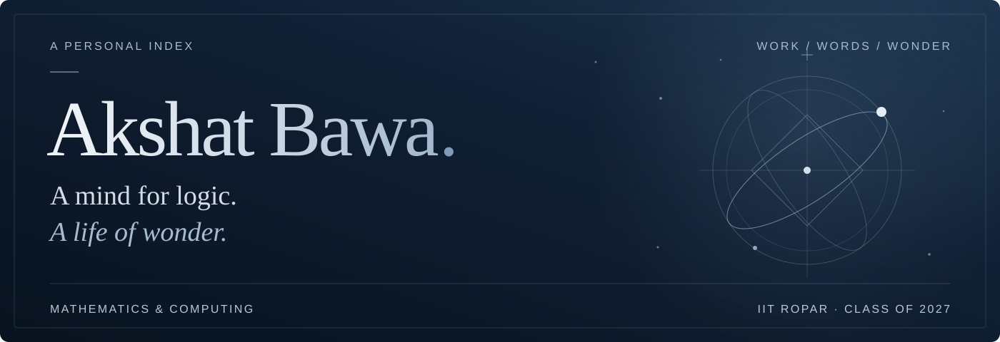

<picture>
  <source media="(max-width: 600px)" srcset="assets/header-midnight-mobile.svg">
  
</picture>

 

  
  
  
  

 

I'm Akshat, a final-year **Mathematics and Computing** undergraduate at **IIT Ropar**, Class of 2027. I like working through difficult questions and turning ideas into useful software.

> **Open to full-time opportunities** 
> AI engineering · Data analysis · Quantitative analysis · Software development

 

### 01 / Selected work

#### [Convo →](https://github.com/Akshat180425/Convo)

Real-time messaging with private and group conversations, shared media, and a contextual AI assistant.

MongoDB · Node.js · React · Socket.IO

#### [Ledgerly →](https://github.com/Akshat180425/Ledgerly)

A personal finance workspace for expenses, budgets, savings goals, and visual insights.

Express · MongoDB · React · Recharts

#### [TradeScope →](https://github.com/Akshat180425/TradeScope)

An educational paper-trading simulator with order execution and portfolio analytics, using synthetic prices and virtual funds.

Node.js · React · Recharts · SQLite

[Explore the projects →](https://akshat180425.github.io/my-portfolio/projects/)

 

### 02 / Learning in practice

**[AWaDH · AI Vicharana Shala →](https://akshat180425.github.io/my-portfolio/experience/#awadh)** 
TEACHING ASSISTANT · MAY–JULY 2024

Helped participants learn machine learning, mathematics, and programming.

**[Evizen AI →](https://akshat180425.github.io/my-portfolio/experience/#evizen-ai)** 
SOFTWARE DEVELOPMENT ENGINEER INTERN · MAY–JULY 2026

Worked on quality assurance and release testing for Unilic, a classroom attendance application.

 

### 03 / Tools for the work

**Data & tools** 
Git · LaTeX · MongoDB · SQLite

**Languages** 
C++ · CSS · HTML · JavaScript · Python

**Web** 
Express · Node.js · React · Socket.IO

 

### 04 / Between the work

Books, music, and philosophy are part of how I connect with the world. I also write poetry in English and Hindi.

**[Library](https://akshat180425.github.io/my-portfolio/library/)** — passages and questions that stay. 
**[Listening Room](https://akshat180425.github.io/my-portfolio/listening-room/)** — familiar voices, different rhythms. 
**[Marginalia](https://akshat180425.github.io/my-portfolio/marginalia/)** — my poems, in the margins.

 

<em>Good conversations don't always begin with work.</em>

