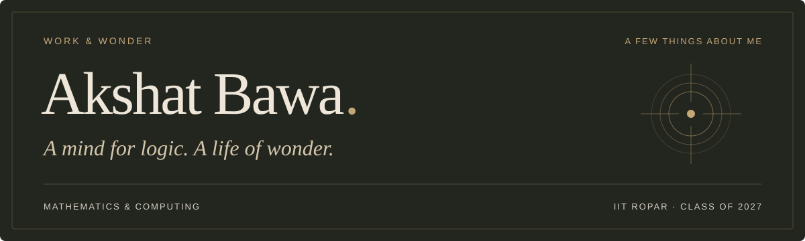

  

  <a href="https://akshat180425.github.io/my-portfolio/">Portfolio</a> &nbsp;·&nbsp;
  <a href="https://www.linkedin.com/in/akshat180425/">LinkedIn</a> &nbsp;·&nbsp;
  <a href="https://mail.google.com/mail/?view=cm&amp;fs=1&amp;to=akshatbawa130806%40gmail.com">Email</a> &nbsp;·&nbsp;
  <a href="https://akshat180425.github.io/my-portfolio/assets/Resume.pdf">Résumé</a>

I'm Akshat, a final-year **Mathematics and Computing** undergraduate at **IIT Ropar**, Class of 2027. I like working through difficult questions and turning ideas into useful software.

I'm looking for **full-time opportunities** in AI engineering, data analysis, quantitative analysis, and software development.

### Selected work

| Project | What I've been building |
| :--- | :--- |
| [Convo](https://github.com/Akshat180425/Convo) | Real-time messaging with private and group conversations, shared media, and a contextual AI assistant. |
| [Ledgerly](https://github.com/Akshat180425/Ledgerly) | A personal finance workspace for expenses, budgets, savings goals, and visual insights. |
| [TradeScope](https://github.com/Akshat180425/TradeScope) | An educational paper-trading simulator with order execution and portfolio analytics, using synthetic prices and virtual funds. |

[Explore the projects →](https://akshat180425.github.io/my-portfolio/projects/)

### Learning in practice

- **[AWaDH · AI Vicharana Shala](https://akshat180425.github.io/my-portfolio/experience/#awadh)** — Teaching Assistant, May–July 2024. Helped participants learn machine learning, mathematics, and programming.
- **[Evizen AI](https://akshat180425.github.io/my-portfolio/experience/#evizen-ai)** — Software Development Engineer Intern, May–July 2026. Worked on quality assurance and release testing for Unilic, a classroom attendance application.

### Tools for the work

**Data & tools:** Git, LaTeX, MongoDB, SQLite 
**Languages:** C++, CSS, HTML, JavaScript, Python 
**Web:** Express, Node.js, React, Socket.IO

### Between the work

Books, music, and philosophy are part of how I connect with the world. I also write poetry in English and Hindi.

The portfolio has a [Library](https://akshat180425.github.io/my-portfolio/library/), a [Listening Room](https://akshat180425.github.io/my-portfolio/listening-room/), and [Marginalia](https://akshat180425.github.io/my-portfolio/marginalia/) for my poems. You're welcome to wander.

---

*Good conversations don't always begin with work.*
